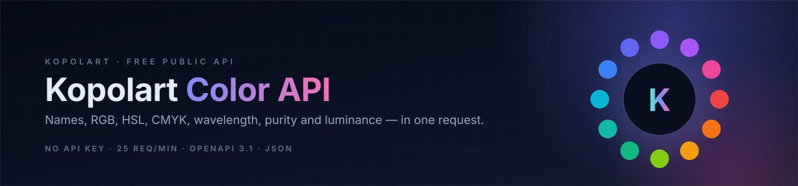

<p align="center">
  
</p>

<p align="center">
  <a href="https://kopolart.ir"></a>
  <a href="https://kopolart.github.io/kopolart-color-api/docs/"></a>
  
  
  
  
  <a href="./LICENSE"></a>
</p>

<h1 align="center">Kopolart Color API</h1>

<p align="center">
  A free, no-key HTTP API that turns any HEX color into a complete color profile —<br>
  bilingual names, RGB, HSL, CMYK, dominant wavelength, purity and luminance.
</p>

<p align="center">
  <a href="#quick-start">Quick start</a> ·
  <a href="#endpoints">Endpoints</a> ·
  <a href="./docs/reference.md">Reference</a> ·
  <a href="./openapi.yaml">OpenAPI spec</a> ·
  <a href="./docs/faq.md">FAQ</a>
</p>

---

## Highlights

- **Free and keyless** — no signup, no token, no billing. Just call the endpoint.
- **Bilingual naming** — Persian and English names, including descriptive adjectives for near matches (e.g. `آبی فیروزهای` / `Turquoise Blue`).
- **More than a converter** — dominant wavelength, excitation purity and relative luminance alongside the usual RGB / HSL / CMYK values.
- **Complements and neighbors** — complementary, analogous, similar colors and similar palettes from a curated color catalog.
- **Fast by default** — server-side caching (24 hours for color profiles, 7 days for discovery endpoints).
- **Predictable** — stable JSON, documented errors, MIT-licensed documentation and examples.

## Endpoints

| Method | Path | Returns | Rate limit | Server cache |
| :----- | :--- | :------ | :--------- | :----------- |
| `GET` | [`/api/color/{hex}`](#1-color-profile) | Full color profile | 25 req/min | 24 hours |
| `GET` | [`/api/complementary-color/{hex}`](#2-complementary-color) | Complement + analogous alternative | 25 req/min | 24 hours |
| `GET` | [`/api/similar-colors/{hex}`](#3-similar-colors) | Up to 3 nearest catalog colors | — | 7 days |
| `GET` | [`/api/similar-palettes/{hex}`](#4-similar-palettes) | Up to 3 nearest palettes | — | 7 days |
| `GET` | [`/api-color/{hex}`](#5-legacy-compact-profile) | Compact profile | 25 req/min | 24 hours |

Base URL: **`https://kopolart.ir`**

## Quick start

### cURL

```bash
curl -sS "https://kopolart.ir/api/color/ff0000"
```

### JavaScript (Node.js 18+)

```js
const res = await fetch("https://kopolart.ir/api/color/ff0000");
if (!res.ok) throw new Error(`Kopolart API responded with ${res.status}`);

const color = await res.json();
console.log(color.persianName, "/", color.englishName);
console.log(color.rgb, color.hsl, color.cmyk);
```

### Python 3

```python
import json
import urllib.request

with urllib.request.urlopen("https://kopolart.ir/api/color/ff0000") as response:
    color = json.load(response)

print(color["persianName"], "/", color["englishName"])
print(color["rgb"], color["hsl"], color["cmyk"])
```

### PHP

```php
<?php
$json = file_get_contents("https://kopolart.ir/api/color/ff0000");
$color = json_decode($json, true, 512, JSON_THROW_ON_ERROR);

echo $color["persianName"] . " / " . $color["englishName"];
```

More runnable samples live in [`examples/`](./examples).

## Conventions

- **HEX input** — 3 or 6 hexadecimal digits, case-insensitive, with an optional leading `#`.
  - `ff0000`, `FF0000` and `f00` are equivalent.
  - In a URL, `#` starts the fragment, so write `%23ff0000` or simply omit it: `/api/color/ff0000`.
- **Response body** — UTF-8 JSON. Persian text is sent as-is, not escaped.
- **Errors** — non-2xx responses are not uniform JSON errors: `400` returns a small ProblemDetails object, while `429` returns the site's HTML error page. Branch on the status code (see [Errors](#errors)).
- **Authentication** — none. Please respect the rate limits.

## Endpoint reference

### 1. Color profile

```http
GET /api/color/{hex}
```

Returns the bilingual name, color-space conversions and scientific attributes.

```bash
curl -sS "https://kopolart.ir/api/color/ff0000"
```

```json
{
  "color": "#FF0000",
  "persianName": "قرمز",
  "englishName": "Red",
  "rgb": { "r": 255, "g": 0, "b": 0 },
  "hsl": { "h": 0, "s": 100, "l": 50 },
  "cmyk": { "c": 0, "m": 100, "y": 100, "k": 0 },
  "wavelength": 611.3,
  "purity": 91.7,
  "brightness": 21.3
}
```

| Field | Type | Notes |
| :---- | :--- | :---- |
| `color` | string | Normalized HEX, uppercase, prefixed with `#`. |
| `persianName` | string | Persian color name. May be empty if no catalog match exists. |
| `englishName` | string | English color name. May be empty if no catalog match exists. |
| `rgb` | object | `r`, `g`, `b` integers in `0–255`. |
| `hsl` | object | `h` in `0–360`; `s` and `l` in `0–100` (percent). |
| `cmyk` | object | `c`, `m`, `y`, `k` in `0–100` (percent). |
| `wavelength` | number | Dominant wavelength in nanometres, one decimal. `0` for achromatic colors. |
| `purity` | number | Excitation purity in percent, one decimal (`0–100`). |
| `brightness` | number | Relative luminance in percent, one decimal (`0–100`). |

### 2. Complementary color

```http
GET /api/complementary-color/{hex}
```

Returns the catalog's best complementary color plus a nearest analogous alternative.

```bash
curl -sS "https://kopolart.ir/api/complementary-color/3366cc"
```

```json
{
  "compHex": "f8b500",
  "compName": "زرد طلایی",
  "compNameEn": "Golden Yellow",
  "compNearHex": "40a2e3",
  "compNearName": "آبی فیروزه‌ای",
  "compNearNameEn": "Turquoise Blue",
  "compDistance": "80.9",
  "compContrast": "14.1",
  "compMix": "#958E66",
  "compTemp": "گرم",
  "compTempVal": "44",
  "nearDistance": "20.6",
  "nearContrast": "9.1",
  "nearMix": "#3A84D8",
  "nearTemp": "سرد",
  "nearTempVal": "204"
}
```

| Field | Type | Notes |
| :---- | :--- | :---- |
| `compHex` | string | Complementary HEX without `#`. |
| `compName` / `compNameEn` | string | Persian / English name of the complementary color. |
| `compNearHex` | string | Analogous alternative HEX without `#`. |
| `compNearName` / `compNearNameEn` | string | Persian / English name of the alternative. |
| `compDistance` | string | Perceptual distance from the input, normalized to `0–100`. |
| `compContrast` | string | Contrast score, normalized to `0–100`. |
| `compMix` | string | 50/50 RGB mix of the input and the complementary color. |
| `compTemp` | string | Persian temperature label: `گرم` (warm), `سرد` (cool), `میانه` (neutral-ish), `خنثی` (achromatic). |
| `compTempVal` | string | Hue in degrees as a string, or `خنثی` for achromatic colors. |
| `near*` | — | Same metrics for the analogous alternative. |

### 3. Similar colors

```http
GET /api/similar-colors/{hex}
```

```bash
curl -sS "https://kopolart.ir/api/similar-colors/ff0000"
```

```json
[
  {
    "span": "FF1818",
    "title": "رنگ قرمز (Red)",
    "image": "/images/color-swatches/thumbnails/red-color-ff1818.jpg",
    "url": "/colors/red-color-ff1818",
    "captionImage": "رنگ قرمز با کد FF1818",
    "dateTime": "0001-01-01T00:00:00"
  }
]
```

| Field | Type | Notes |
| :---- | :--- | :---- |
| `span` | string | Uppercase HEX of the suggested color. |
| `title` | string | Persian display title with the English name in parentheses. |
| `image` | string | Relative image path — prepend `https://kopolart.ir`. |
| `url` | string | Relative page path — prepend `https://kopolart.ir`. |
| `captionImage` | string | Persian alt text / caption. |
| `dateTime` | string | Reserved. Currently the default .NET value. |

> Returns **up to 3** colors, ordered by perceptual closeness.

### 4. Similar palettes

```http
GET /api/similar-palettes/{hex}
```

Accepts a single HEX value.

```bash
curl -sS "https://kopolart.ir/api/similar-palettes/ff0000"
```

```json
[
  {
    "span": "3,326",
    "title": "پالت رنگ نسکافه ای، قهوه‌ای، کرم و آبی نفتی",
    "image": "/images/palettes/thumbnails/brown-petrol-blue-palette-865131.jpg",
    "url": "brown-petrol-blue-palette-865131",
    "captionImage": "پالت رنگ نسکافه ای، قهوه‌ای، کرمی و آبی نفتی",
    "dateTime": "0001-01-01T00:00:00"
  }
]
```

| Field | Type | Notes |
| :---- | :--- | :---- |
| `span` | string | Palette copy count, formatted with thousands separators. |
| `title` | string | Persian palette title. |
| `image` | string | Relative image path — prepend `https://kopolart.ir`. |
| `url` | string | Palette slug **without** a leading slash — prepend `https://kopolart.ir/`. |
| `captionImage` | string | Persian alt text / caption. |
| `dateTime` | string | Reserved. Currently the default .NET value. |

> Returns **up to 3** palettes. If nothing is close enough, a set of popular palettes is returned.

### 5. Legacy compact profile

```http
GET /api-color/{hex}
```

A shorter, string-only payload kept for backward compatibility. Note the different prefix (`/api-color`, hyphen).

```bash
curl -sS "https://kopolart.ir/api-color/f00"
```

```json
{
  "message1": "Pure Vibrant Red",
  "message2": "611",
  "message3": "91.7"
}
```

| Field | Type | Notes |
| :---- | :--- | :---- |
| `message1` | string | English descriptive name of the nearest catalog color. |
| `message2` | string | Dominant wavelength in nanometres, as a string. |
| `message3` | string | Excitation purity in percent, as a string. |

## Errors

| Status | Meaning | Body |
| :----- | :------ | :--- |
| `400 Bad Request` | Missing or invalid HEX value. | ProblemDetails JSON (`type`, `title`, `status`, `traceId`) |
| `429 Too Many Requests` | Rate limit exceeded. Back off and retry after a minute. | Site HTML error page |
| `500 Internal Server Error` | Unexpected server error. | Site HTML error page |

The error body is not part of the API contract — always branch on the status
code before parsing JSON.

## Rate limits and caching

- **25 requests per minute per IP** on `/api/color`, `/api/complementary-color` and `/api-color`, measured as a sliding window per endpoint.
- The discovery endpoints (`/api/similar-colors`, `/api/similar-palettes`) have no dedicated limiter and are cached for **7 days**.
- Color profiles and complements are cached server-side for **24 hours**; identical URLs return the same payload without recomputation.
- Sustained traffic above the limit receives `429`. There is no paid tier — please cache results on your side and avoid retry storms.

## Browser usage (CORS)

The API does **not** currently send CORS headers. Browser `fetch` calls from another origin are therefore blocked by the browser, even though the endpoint itself works. Use one of these:

- call the API from your **server**, build step, bot or native app;
- proxy it through your own backend or serverless function;
- open an issue here if you need first-class browser access.

## Responsible use

- Cache color profiles and discovery results; a color's profile never changes.
- Link back to [kopolart.ir](https://kopolart.ir) when the data is presented publicly.
- Do not mirror or bulk-scrape the catalog to build a competing service.
- The API is free and provided **as-is**, without warranty.

## Documentation

| Resource | Description |
| :------- | :---------- |
| [`docs/quickstart.md`](./docs/quickstart.md) | Setup-free examples in four languages. |
| [`docs/reference.md`](./docs/reference.md) | Detailed endpoint, field and edge-case reference. |
| [`docs/errors-and-limits.md`](./docs/errors-and-limits.md) | Status codes, backoff and caching guidance. |
| [`docs/faq.md`](./docs/faq.md) | Common questions. |
| [`openapi.yaml`](./openapi.yaml) | OpenAPI 3.1 description — generate clients or validate integrations. |
| [`docs/index.html`](./docs/index.html) | Redoc-based interactive reference for GitHub Pages. |

### Interactive reference

Enable GitHub Pages with **Source: Deploy from a branch → `main` → `/(root)`**, then open:

```text
https://kopolart.github.io/kopolart-color-api/docs/
```

The page loads `../openapi.yaml`, so the repository root must be the published
source. It renders the spec with Redoc; no build step is required.

## FAQ

**Is it really free?** Yes. No key, no account. The only constraint is the published rate limit.

**Why is `wavelength` zero?** Greys, white and black have no dominant wavelength, so the API returns `0`.

**Why does `compTempVal` sometimes contain text?** Achromatic complements return `خنثی` ("neutral") instead of a hue angle.

**Does it support alpha / RGBA / 8-digit HEX?** No — 3 or 6 digits only.

**Can I use the data commercially?** Yes. Attribution is appreciated, not required.

**Is the server source code public?** No. This repository is documentation-only.

See [`docs/faq.md`](./docs/faq.md) for more.

## Contributing

Corrections, example ports and documentation improvements are welcome — see [`CONTRIBUTING.md`](./CONTRIBUTING.md). For security issues, follow [`SECURITY.md`](./SECURITY.md).

## License

Documentation and example code in this repository are released under the [MIT License](./LICENSE).

The hosted API at `kopolart.ir` is a free service provided as-is; this license does not grant access to its server implementation or database.
